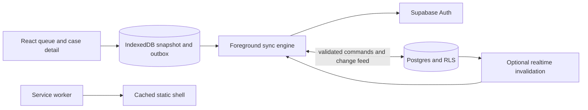

# RepairRelay — offline repair-event handoff

Status: proposed implementation · Priority: third · Effort: 130–185 focused hours.

Read [shared engineering standards](ENGINEERING.md) and [research](RESEARCH.md). This is the only baseline project requiring a hosted database, and its public sample also runs entirely locally.

## 1. Existing problem and target user

At a community repair event, a reception volunteer registers an item, a repairer diagnoses it and another volunteer records the outcome. Paper notes or separate spreadsheets make handoff hard, particularly when Wi-Fi drops. A case may be assigned twice or a later note overwrite an earlier repairer's work.

RepairRelay is a mobile-first shared case queue with explicit local/synced states, a handoff trail and reviewable conflicts. It covers one event at a time. The outcome is a usable case record and export after the event, not a decorative Kanban board.

The [Open Repair Alliance](https://openrepair.org/about/) documents community repair data collection, and its [Open Repair Data Standard](https://standard.openrepair.org/standard.html) provides a reference for outcome exports. [ODK Collect](https://docs.getodk.org/collect-intro/) is an established offline collection alternative. RepairRelay's proposed niche is collaborative handoff between volunteers. No affiliation, certification or unmet-market claim is implied.

### Discovery gate

Speak with two repair-event organisers and three volunteers. Walk through an actual event's intake, assignment, handoff and close-out using synthetic records. Compare existing RepairMonitor, ODK or spreadsheet workflows before building. Proceed only if organisers need shared case status or conflict visibility that their current setup lacks. If the need is only offline form capture, adopt/configure an existing tool instead.

Pilot target: five volunteers can complete a 20-case simulated event, including ten offline changes and one intentional edit conflict, without losing an acknowledged local save. Then conduct one small permitted live pilot before claiming real-world usefulness. Record time-to-handoff and duplicate assignments against the current process; do not invent improvement percentages.

## 2. V1 scope and critical journeys

1. Organiser creates an event and adds signed-in volunteers by exact account identity. No public event signup or automated invitation email is needed initially.
2. Reception records an item category, short fault description and anonymous ticket number. No visitor names, contact details, exact address or medical/sensitive data.
3. Repairer claims a case while online, starts work and adds notes. Assignment is authoritative only after server confirmation.
4. While offline, volunteers can create intake drafts and append notes/update their own assigned cases. The interface says changes are pending and may require review.
5. On reconnection, queued commands sync; conflicting edits show base, local and server values. The user selects or combines explicitly.
6. Organiser closes cases with an outcome and exports a schema-validated summary. Closing an event is blocked while the current device has unsynced work; other devices' pending work cannot be known and must be addressed through the event close checklist.

V1 states: queued, in-progress, waiting-for-part, completed, unrepairable; export outcomes mapped explicitly to the selected ORDS version rather than equating operational status with a repair outcome. “Completed” requires an outcome. A closed event is read-only server-side; late offline changes are preserved for export/manual review, not silently accepted.

Out of scope: payments, customers' identities, photos/files, live chat, maps, routing, inventory purchasing, repair safety instructions, CRDT text editing and a full volunteer management suite. Notes are plain text, bounded to 2,000 characters. Photos are a later validated request because media sync greatly increases storage and privacy complexity.

## 3. Design and screen behavior

Human: a volunteer holding a phone beside a busy repair table. Task: see who owns an item and what the next person needs to know. Feel: clear, sturdy and honest about connectivity.

Domain vocabulary: ticket, bench, fault, owner, handoff, outcome, queued change. Color world: cream ticket paper, graphite workbench labels, orange pending tags, blue assignments, green completed marks. Signature: each case carries a compact handoff strip showing confirmed owner, last server update and this device's pending changes. Repeat this in queue rows, detail header, edit footer, sync centre and conflict review.

Avoid drag-and-drop-only status changes, floating success toasts as proof of persistence, and a map/dashboard unrelated to the task. Use a list on phones, with filtering by assignment and status. A desktop split view supports reception's faster data entry.

Routes: `/demo`, `/events`, `/events/:id/queue`, `/events/:id/cases/:caseId`, `/events/:id/sync`, `/events/:id/export`, `/settings/device`. Guest demo is local and clearly labeled. Signed-in team mode is a separate entry; changing modes never mixes stores.

Queue row: ticket number, item/fault, confirmed owner, status, pending badge. Detail: latest handoff note first, timeline below, primary action based on role/state. Sync centre: pending count, last successful sync, retry, export pending work and conflicts. An offline assignment is shown as “request pending,” never confirmed ownership.

Tokens: `--ticket: #FFFDF7`, `--bench-ink: #222B33`, `--assigned: #2457A7`, `--pending: #8A4B08`, `--resolved: #166534`; verify contrast. Body 16px, ticket ID 24px/tabular, section titles 20px; touch actions 44–48px; 4px spacing base, 16px screen inset and 12px row padding. Use system fonts for dependable offline rendering. Border/surface changes establish depth; motion is limited to status transitions under 200ms with reduced-motion support.

Accessibility: ordinary buttons for state transitions; labeled status text; live region summarises a batch sync once. Preserve focus during polling. Conflict view uses explicit labeled columns or stacked groups on mobile, and a “Review next conflict” action. Every change is possible by keyboard without dragging.

## 4. Architecture and boundaries

Stack: React/TypeScript/Vite, Dexie, service worker through a maintained PWA integration, Supabase Auth/Postgres, TanStack Query for remote reads and Zod at command boundaries. Server transactions use narrowly scoped Postgres functions. No separate custom backend framework is necessary.



The local snapshot plus pending command projection drives the UI. TanStack Query owns fetched server snapshots, not a competing optimistic command queue. Reconcile fetched snapshots into local storage using one adapter. Realtime is an optional freshness hint; durable pull sync remains authoritative. Foreground reconnect/manual sync works without Background Sync API, which is not universally available.

```text
src/features/cases/      queue, intake, detail and handoff
src/features/sync/       pending/conflict UI
src/domain/              commands, permissions and projection
src/local/               Dexie schema, transactional outbox
src/sync/                push/pull, backoff, reconciliation
src/api/                 Supabase adapter and response validation
src/demo/                local server simulator, synthetic events
supabase/migrations/    tables, indexes, policies and RPCs
supabase/tests/         authorization and concurrency tests
docs/                   sync protocol, operations and decisions
```

## 5. Data model and authorization

| Table              | Fields and constraints                                                                                                      |
| ------------------ | --------------------------------------------------------------------------------------------------------------------------- |
| `events`           | id, owner_id, title, event_date, timezone, status, change_seq, next_ticket_no; event row is the sync serialization lock     |
| `event_members`    | event_id, user_id, role(owner/coordinator/repairer); unique pair                                                            |
| `repair_cases`     | id(UUID), event_id, ticket_no, category, fault, assigned_to, status, outcome, version, archived_at; unique ticket per event |
| `case_notes`       | id(UUID), case_id, author_id, body, created_at, command_id; immutable append, corrections are new notes                     |
| `applied_commands` | event_id, actor_id, command_id, payload_hash, result; unique event/actor/command                                            |
| `event_changes`    | event_id, seq, entity_id, kind, snapshot/tombstone; unique event/seq                                                        |

Local tables: serverSnapshots, pendingCommands, draftForms, syncCursors and conflicts, partitioned by account/event. A local mutation and its outbox command are written in one IndexedDB transaction. Do not display “saved on this device” before commit succeeds.

Offline intake uses a client UUID and a visibly provisional local reference. The server allocates the final event ticket number under the event lock when `CREATE_CASE` succeeds; it never trusts a device-generated sequential ticket. Notes queued against a new case depend on its create command and wait until that command is acknowledged. Owner/coordinator roles handle intake in v1; a separate receptionist role is a later need, not an implicit permission.

RLS limits reads to event members; ordinary clients cannot modify membership/roles or bypass command RPCs. Membership changes require owner permission server-side. Repairers may add notes and update cases assigned to them; coordinators assign/reassign/close; owners manage event membership. Claiming unassigned cases is online-only and atomic. UI disabling is convenience, never enforcement.

Use authenticated security-invoker functions where policies support the operation. If a security-definer function is required for atomic command processing, harden it: empty search_path, schema-qualified names, explicit `auth.uid()`/membership/role checks, bounded arguments, no dynamic SQL, revoked public execution and narrowly granted authenticated execution. Test every operation across two unrelated events. No service-role key in client code or public PR workflows. See Supabase RLS reference T8.

## 6. Sync protocol and concurrency

Command envelope: `commandId`, `eventId`, `caseId`, `baseVersion`, `kind`, `payload`, `clientCreatedAt`; the server derives actor identity and authoritative time. A client timestamp is not ordering authority.

1. Persist optimistic local projection and command atomically. The queue survives refresh. Process commands FIFO per case, with bounded concurrency across cases. Record a dependency on the previous pending command for that case. Coalesce unsent field edits into one explicit patch where safe; never change an already-sent command's payload. After acknowledgment, advance dependent commands to the returned version only if their recorded preconditions still match; otherwise surface a conflict rather than blindly rebasing.
2. `apply_command` starts a transaction and locks the event row. For this small event workload, deliberate serialization is simpler than a scalable distributed log.
3. Validate authenticated membership, allowed operation, event open status and payload size. Check command identity: if previously applied with the same payload hash, return the stored result; if same ID/different payload, reject.
4. Lock/check case version. A stale mutation returns a typed conflict containing current version/snapshot. Append-only note commands can succeed without overwriting fields, subject to permissions.
5. Apply allowed change, increment case version and the event's `change_seq`, append change/audit data and store command result in the same transaction. Holding the event lock ensures sequence order matches commit order; do not substitute an uncoordinated sequence cursor that can skip late-committing transactions.
6. The client records the returned snapshot and removes the command in one local transaction. Lost responses are retried with the original command ID.
7. Pull changes after the saved cursor, ordered by seq, with a bounded page size. Advance cursor only after persisting the full batch. Deletes/archive use tombstones. Initial event bootstrap fetches a transactionally consistent snapshot plus high-water cursor.
8. A conflict stops dependent commands for that case. Present base/local/server differences; an accepted resolution creates a new command against the latest version, preserving old intent in local history until resolved.

Retry transient network/5xx failures with jittered exponential backoff capped at 60 seconds. Authentication expiry pauses and asks for reauthentication without deleting drafts. Permission removal produces a clear non-retryable result; retain a local export option subject to the user's existing local copy. Browser online status is a hint; confirm service reachability with actual requests. All requests have timeouts.

Two tabs use a local lease with expiry and a BroadcastChannel notification where supported; idempotency remains the safety net if both attempt a send. Do not infer ownership from a lease alone. Bound client queue to 500 commands/event and explain/export when full. Retain server command results for the full event lifetime in v1; deleting idempotency records early could replay an old mutation.

## 7. Offline lifecycle, failure and privacy

Cache static shell/assets only, never auth responses or shared API responses in a generic service-worker cache. Download the current event intentionally before going offline. First visit without network shows a truthful “open once online” explanation rather than a broken app. Show last confirmed server time and pending count continuously.

Use a waiting service-worker update prompt. Apply it after local writes have completed and persistence migrations are compatible; do not auto-refresh while editing. Old/new client command schema versions are negotiated; unsupported versions remain exportable and prompt an update. Browser storage may be cleared/evicted; request persistence where available and provide a regular local backup action. Do not claim offline data is indestructible.

On logout/account switch, warn about unsynced work and offer export, sync or cancellation; clearing local event data must be deliberate. Do not send another user's queued commands after account change. Demo and signed-in storage namespaces differ. Notes must exclude visitor personal details; provide content guidance at intake and export review.

No analytics containing case notes. Local diagnostic export contains command counts, error codes, versions and timing only. An organiser can export/delete an event through an authorized flow after pending-work checks; document that other devices may retain local copies and require clearing.

## 8. Acceptance tests and operating envelope

| Scenario                              | Required outcome                                                         |
| ------------------------------------- | ------------------------------------------------------------------------ |
| Submit, server commits, response lost | Retry returns original result; exactly one logical mutation/note         |
| Two users claim same case             | One succeeds; other sees current owner and no false confirmation         |
| Offline edit versus online edit       | Explicit conflict; neither person's intent silently lost                 |
| Ten edits then refresh offline        | Locally acknowledged changes and pending count restore                   |
| Network flaps during batch            | Each command applied once; cursor resumes without missing changes        |
| Role revoked/token expires            | Server rejects unauthorized mutation; client pauses/preserves local work |
| Concurrent feed commits               | Serial event sequence produces no skipped committed changes              |
| IndexedDB full/service worker update  | No false save; export/recovery and safe update path                      |
| Account A then account B              | No A data rendered or commands submitted as B                            |
| Event closed with pending changes     | Typed rejection and manual export/review, not silent discard             |

Test pure projection/permissions in Vitest, browser offline/reload in Playwright and RPC/RLS in local Supabase database tests. Run a two-browser-context race test against a real local database, not only mocks. Use deterministic network failure injection. Device trial on one real Android phone and one available iOS Safari device; record unavailable devices as untested.

Initial envelope: one active event with 500 cases, ten concurrent volunteers and 5,000 total notes/changes. Load-test the serialized RPC before expanding. Targets: local save acknowledgment below 150ms p95 on the documented test device; restore 500-case snapshot below two seconds; sync 100 small commands within 30 seconds on the documented network. These are targets, not guarantees. Show paginated/filterable lists; no need for massive virtualization at this scale.

## 9. Milestones and issue backlog

| Milestone             | Deliverables                                                                      | Exit gate                                                      | Hours |
| --------------------- | --------------------------------------------------------------------------------- | -------------------------------------------------------------- | ----- |
| M0 Discovery/protocol | Event walkthrough; scope; sync ADR; permission matrix; fixtures                   | A coordinator validates the handoff problem                    | 10–14 |
| M1 Local alpha        | Intake/queue/detail; local transactional outbox; simulated sync and conflicts; CI | Complete sample event without cloud account                    | 24–32 |
| M2 Team backend       | Auth; migrations/RLS; command RPC; change feed; two-context tests                 | Idempotency and cross-event isolation tests pass               | 32–44 |
| M3 Offline beta       | PWA lifecycle; real push/pull; conflict UI; recovery/account switch               | Offline/reconnect/refresh sequence loses no acknowledged write | 30–42 |
| M4 Pilot/release      | Export mapping; mobile/a11y; load evidence; operations/restore; contributor docs  | Simulated pilot plus documented findings and v1 tag            | 34–53 |

Dependencies: permission matrix before RPCs; idempotency before retries; atomic outbox before offline claims; consistent cursor protocol before realtime; conflict resolution before inviting multiple pilot users. Realtime subscriptions are a stretch enhancement, not a blocker to reliable polling/manual sync.

## 10. Contributions, deployment and evidence

Six starter tasks: (1) synthetic repair-category fixture, (2) sync-status screen-reader test, (3) empty queue copy, (4) a documented export mapping fixture, (5) mobile conflict view screenshot test, (6) troubleshooting guide for blocked browser storage. Protocol changes and database policies require maintainer review; keep these off the beginner list.

Host the frontend on Cloudflare Pages. Use one Supabase Free project for opt-in team pilots, [Google OAuth through Supabase](https://supabase.com/docs/guides/auth/social-sign-in/auth-google) and owner-managed membership. Validate provider accessibility with the actual volunteers during discovery; do not require nontechnical volunteers to create GitHub accounts. Local demo needs no login. Use standard identity scopes only, configure the consent screen and allowed test users before the pilot, and document provider approval/setup requirements. Document OAuth redirect URLs per trusted environment and local setup; previews have no production credentials. Public Supabase URL/publishable key is not a substitute for RLS.

Budget cap: 50 pilot accounts, five events, 10,000 cases total, no attachments; measure DB/egress usage monthly and stop new event creation with an explanation before limits. Supabase may pause on inactivity; show service-unavailable with local work intact and give the maintainer manual resume instructions. Do not keep it artificially active. Export pilot data before destructive changes; test local restore. Backups/self-hosting are migration options, not a promised free managed SLA.

Demo story: register a kettle, confirm assignment, disconnect one browser, edit in both browsers, reconnect, resolve a conflict and export the event. Case study: why explicit conflicts beat last-write-wins, why a serial event lock fits this scale, what offline cannot guarantee, and what a volunteer trial changed. This is the main distributed-state and ownership evidence in the portfolio.
